  

# QA Tech Labs

### AI-Powered Quality Engineering · Test Automation · Engineering Innovation

**Engineering Quality. Intelligently.**

Building a premium engineering lab focused on scalable automation,
AI-assisted testing, and modern quality engineering systems.

[Website](https://qatechlabs.com) •
[Repositories](https://github.com/orgs/qatechlabs/repositories) •
[Contact](mailto:karthik@qatechlabs.com)

---

## About QA Tech Labs

QA Tech Labs is a quality engineering initiative focused on building
reliable, maintainable, and intelligent testing systems.

We explore the intersection of:

- **Test automation architecture**
- **AI-assisted quality engineering**
- **API and integration validation**
- **CI/CD-driven quality practices**
- **Reusable engineering frameworks**
- **Practical education for modern testers**

Our goal is to make quality engineering more
**intelligent, scalable, and engineering-driven**.

---

## Engineering Focus

| Area | Focus |
|---|---|
| **Test Automation** | Playwright, TypeScript, reusable frameworks, scalable design |
| **AI in QA** | AI-assisted test generation, diagnostics, intelligent workflows |
| **API & Integration Testing** | REST APIs, contract validation, integration quality |
| **Framework Architecture** | POM, fixtures, reusable utilities, configuration-driven execution |
| **CI/CD & Quality Gates** | pipeline integration, parallel execution, reporting, release confidence |
| **Engineering Enablement** | practical learning, reusable resources, real-world QA patterns |

---

## Technology Stack

---

## Selected Initiatives

> These reflect the engineering directions of QA Tech Labs. Repositories will be featured here as they are published.

| Initiative | Direction |
|---|---|
| **Enterprise Playwright Frameworks** | scalable UI and API automation foundations |
| **AI-Assisted Testing** | practical agents for test design, diagnostics, and acceleration |
| **API Quality Tooling** | contract testing, validation utilities, and integration confidence |
| **QA Learning Resources** | practical engineering guidance and reusable examples |

---

## Engineering Principles

- Build automation for **reliability**, not just execution.
- Treat test frameworks as **production-grade software**.
- Validate **business outcomes**, not only UI behavior.
- Prefer **maintainable systems** over brittle shortcuts.
- Use AI to **amplify engineering judgment**, not replace it.
- Share practical knowledge through **open and reusable assets**.

---

## Connect With Us

**Website:** [qatechlabs.com](https://qatechlabs.com)  
**Email:** [karthik@qatechlabs.com](mailto:karthik@qatechlabs.com)  
**GitHub Organization:** [github.com/qatechlabs](https://github.com/qatechlabs)

---

  

