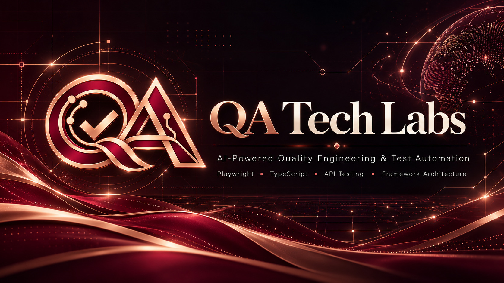

  

# QA Tech Labs

### Engineering Quality. Intelligently.

**AI-Powered Quality Engineering · Test Automation · Engineering Innovation**

Building a community-driven engineering lab focused on
reliable automation, intelligent testing, and scalable
quality engineering systems.

[Website](https://qatechlabs.com) ·
[Explore Repositories](https://github.com/orgs/qatechlabs/repositories) ·
[Get in Touch](mailto:karthik@qatechlabs.com)

---

## Who We Are

**QA Tech Labs** is a quality engineering initiative exploring
the intersection of software testing, automation architecture,
and artificial intelligence.

We believe test automation should be treated as engineering
infrastructure — designed for reliability, maintainability,
observability, and continuous improvement.

Our mission is to make modern quality engineering more
accessible, intelligent, and effective.

---

## Our Engineering Focus

| Domain | Focus |
|:---|:---|
| **Test Automation** | Playwright, TypeScript, reusable frameworks, and scalable design |
| **AI in Quality Engineering** | AI-assisted test generation, intelligent diagnostics, and agentic workflows |
| **API & Integration Testing** | REST APIs, contract validation, integration testing, and data integrity |
| **Framework Architecture** | Page Object Model, fixtures, test-data management, and configuration-driven design |
| **CI/CD & Quality Gates** | Automated pipelines, parallel execution, reporting, and release confidence |
| **Engineering Education** | Practical learning, reusable resources, and real-world testing practices |

---

## Technology Ecosystem

**Automation & Programming**

**Delivery & Engineering**

---

## What We're Exploring

Our initial engineering roadmap focuses on four areas.

| Initiative | Direction |
|:---|:---|
| **Enterprise Playwright Frameworks** | Scalable UI and API automation foundations |
| **AI-Assisted Testing** | Practical agents for test design, diagnostics, and automation |
| **API Quality Tooling** | Contract testing and integration validation utilities |
| **QA Engineering Resources** | Learning material, examples, and reusable patterns |

> These are engineering directions, not claims of completed or released products. Public repositories will be featured as they become available.

---

## Our Engineering Principles

- **Reliability by design** — Build trustworthy and deterministic automation.
- **Maintainability first** — Treat test code as production-grade software.
- **Quality beyond the UI** — Validate APIs, integrations, data, and business outcomes.
- **Automation with purpose** — Prioritize meaningful coverage over inflated test counts.
- **Responsible AI adoption** — Use AI to enhance engineering judgment and verification.
- **Open collaboration** — Share reproducible examples and practical knowledge.

---

## Connect & Collaborate

We're interested in practical innovation across
test automation, AI-powered testing, and engineering tooling.

**Have an idea, collaboration proposal, or engineering challenge?**

Reach us at **[karthik@qatechlabs.com](mailto:karthik@qatechlabs.com)**

---

**QA TECH LABS**

*Engineering Quality. Intelligently.*

[Website](https://qatechlabs.com) ·
[GitHub](https://github.com/qatechlabs)

